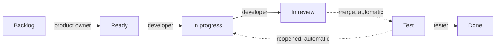
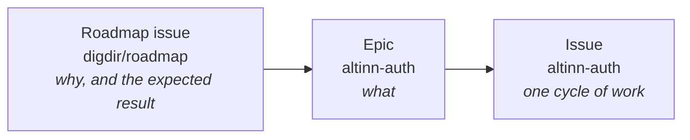

# ADR-0005: How work is planned and flows on the shared board

- **Status:** Proposed
- **Date:** 2026-10-13
- **Deciders:** `@altinn/team-access-management` and `@altinn/team-access-info`, through review of the PR that adds this ADR and a joint workshop
- **Supplements:** [ADR-0004](0004-issue-and-label-model.md)

Drafted with AI assistance (Claude) on 2026-10-13 and restructured with the same assistance on 2026-10-19 as a proposal for the two teams to settle at the workshop. Human reader of the restructured text: not confirmed. The open questions at the end are for the workshop; the decision section records the proposal as it stands.

**TL;DR**

- The shared project board is the single source of truth for what is being worked on and where it stands. Work that is not on the board does not exist. Moving your own card is part of finishing the work.
- Each role has a fixed set of fields it sets and moves it makes. Two-week cycles shared by both teams: planning on the first Monday, weekly refinement, review on the last Friday.
- Six columns, each a handoff to a different person: Backlog → Ready → In progress → In review → Test → Done. Closed and Done are two states: an issue closes when its pull request merges, and the board status says whether it is verified. Production follows the weekly release routine, not the board and not the milestone.
- Horizon answers *when*, priority answers *in which order within that*, milestone answers *which target*. `urgent` requires a date.
- Every discussion ends with one written line in the issue. The Team field becomes Fokusområde on 1 January 2027, by a CODEOWNERS change as ADR-0004 foresees. Fokusområde is a set of `area/*` components, not a layer.

## Context

ADR-0004 gave every issue a type, a component and a capability, moved releases to milestones, and put priority, horizon and progress on the shared project board as fields. It stopped there on purpose: it is a model for *classifying* work, not for *planning* it.

The next questions follow from it, and this ADR proposes answers so the two teams can decide them together:

- Who sets which field, who moves which card, and who owns what.
- When planning, refinement and review happen, and what each is for.
- What each column means, when a card moves, and what "closed" and "done" each mean.
- What a card needs before it is Ready, and before it is Done.
- How a discussion is closed, and how quarterly goals, roadmap items and Epics link, so "why does this matter" can be read from the board.

## Decision

We will use one flow, with one mechanism per question, built on ADR-0004. The sections follow the order of the workshop: who does what, when, how a card flows, what Ready and Done mean, and how decisions are kept.

### 1. Roles and responsibilities

The table says which fields each role sets, which moves on the board it makes, and what it is responsible for. A field is set only by the role listed for it, and a card is moved only by the role listed for that move. If a field or a column is wrong, the role listed for it corrects it; others point it out in the issue.

| Role | Sets | Moves | Owns |
| --- | --- | --- | --- |
| Product owner | Horizon at triage; priority and milestone at planning, adjusted at refinement | Backlog → Ready | The order of Ready and the goals a cycle serves. Decides what leaves the cycle when something urgent comes in. |
| Scrum master | Nothing on the card | Nothing on the card | The three meetings: timebox, shape, and that each discussion ends with a written line. Posts the Friday review. |
| Tech lead | Nothing on the card | Nothing on the card | Settles technical questions a discussion parks, and decides when a cross-component decision becomes an ADR. |
| Fokusområde owner | Type and `area/*` at triage; acceptance criteria are complete before Ready | Nothing on the card | The components in the fokusområde; fallback for security alerts nobody has picked within a day; reviewer from the other area on cross-area issues. |
| Designer | Research findings and the design in the issue before Ready, for changes users will see | Their own research and design cards: Ready → In progress → In review → Done | That a change users will see is tested with users before it is built, where the Epic calls for it; that it has a design to build and verify against; and that the built result matches it. |
| Developer | Nothing beyond the issue text | Ready → In progress → In review; back to Ready with a handover note | Their own card: at most two in In progress, pull request opened, review requested. |
| Tester | The verification result in the issue | Test → Done, or reopens the issue | That verification in AT is done by someone other than the author, against the acceptance criteria. |
| Vakt | `kind/incident`, `urgent` and the current milestone on an incident | Incident straight to In progress | Vendor and client questions in Slack and support cases from the CRM, off the board; creates an issue when a case needs a code change or a release. |

Scrum master and tech lead are roles, not positions: one person can hold a role for both teams. Who sets what for issues that span both teams is open question 2.

### 2. Cycle and meetings

Two-week cycles, shared by both teams from the next cycle, so that the way of working is already common when the teams become one. Three fixed meetings, each with one job, around the weekly deploy routine:

|        | Monday                           | Tuesday     | Wednesday                                 | Friday                         |
| ------ | -------------------------------- | ----------- | ----------------------------------------- | ------------------------------ |
| Week 1 | **Planning**, 30 min, both teams | Prod deploy | TT02 deploy · Refinement, 45 min per team |                                |
| Week 2 |                                  | Prod deploy | TT02 deploy · Refinement, 45 min per team | **Review**, 30 min, both teams |

- **Planning, first Monday of the cycle, 30 minutes, both teams.** The product owner states which goals the cycle serves. The team pulls from the top of Ready. The result is the cycle's iteration on the board. Nothing else is discussed. Planning sets the In progress column to its limit.
- **Refinement, once a week, 45 minutes at most.** Each team keeps its own slot until January, but the shape is the same: triage of `status/triage` issues first (type, area, horizon, priority), then fill Ready from the top of the prioritised view by checking the Definition of Ready (4), then stop. It is not a forum for open-ended discussion. The `lukkekandidater` skill ([#4615](https://github.com/Altinn/altinn-auth/pull/4615)) runs before refinement and reports open issues that look finished, without closing anything.
- **Review, last Friday of the cycle, 30 minutes, both teams.** What reached Done against the milestone, what did not and why, one thing to do differently. One person posts the answers in the team channel; that post is the status report. The delivery part comes from the `ukesrapport` skill ([#4615](https://github.com/Altinn/altinn-auth/pull/4615)): closed issues, merged pull requests, releases and Epic progress for the week, grouped per `area/*`. The team adds what did not reach Done, why, and one thing to do differently. Until the skill reads board status, it reports what is merged; what is verified is read from the Done column.

Planning and review are new; refinement replaces grooming in each team rather than adding to it. No other recurring meeting is added without naming which existing one shrinks or ends. Planning opens the cycle and review closes it (open question 9 for the days).

### 3. Flow on the board

**The board is the truth.** All planned work is an issue on the shared project board. Work handled within the weekly vakt rotation is the one exception (open question 6); it becomes an issue when it needs more than the vakt can do. A developer moves their own card as the work moves; the tester moves it to Done. Progress is read from the board status and from the Friday review post, never from whether the issue is open or closed.

**One issue from start to finish.** This is the path every planned issue takes. Each step names who acts and what the board shows afterwards.

1. Anyone creates the issue with the repository's issue form. It lands in Backlog with `status/triage`.
2. At the next refinement, the fokusområde owner sets type and `area/*`, and the product owner sets horizon and priority. If the issue is too big for one cycle, it becomes an Epic with sub-issues, each linked to the roadmap item it serves (7).
3. When the issue meets the Definition of Ready (4), the product owner moves it to Ready; `status/triage` and `status/draft` are removed. At planning the product owner sets the milestone, and the team pulls it into the cycle's iteration from the top of Ready.
4. A developer moves it to In progress, with at most two cards there at a time. If the work stops because of someone else, the card keeps its column and gets `status/blocked` with a "blocked by" link.
5. The developer opens a pull request whose description says `Resolves: #<issue>`, requests review, and moves the card to In review.
6. Someone other than the author reviews. When the pull request is merged, GitHub closes the issue, the *Item closed* workflow moves the card to Test, and the merge deploys the change to AT.
7. A tester other than the author picks the card from Test, verifies the change in AT against the acceptance criteria, and writes the result in the issue. Verified: the tester moves the card to Done, and the board's *Auto-archive items* workflow archives it. Not verified: the tester reopens the issue, the *Item reopened* workflow moves the card to In progress, the owner is notified, and the path continues from step 5.
8. The change reaches TT02 on the next Wednesday and production on the next Tuesday with the weekly deploy, whether or not the card is in Done. The Friday review reports the issue under its milestone.

**Status (columns)** answers *where the work is*. Each column is a state of the work, and each move is a handoff to a different person. The arrow labels say who moves the card; dashed arrows are made by the board's built-in workflows when the issue closes or reopens.

| Column      | Meaning                                                                                  | Next person              |
| ----------- | ---------------------------------------------------------------------------------------- | ------------------------ |
| Backlog     | Known, not planned. May lack milestone, priority and acceptance criteria.                | Product owner, at triage |
| Ready       | Definition of Ready met (4). Anyone can pull it.                                         | A developer              |
| In progress | Being built. Column limit: roughly the number of developers; personal rule: at most two. | The developer            |
| In review   | Pull request open. Reviewed by someone other than the author.                            | A reviewer               |
| Test        | Merged and deployed to AT. Verified by someone other than the author.                    | A tester or peer         |
| Done        | Definition of Done met (5).                                                              | Nobody                   |

Production is not a column. Merging to main deploys to AT automatically; TT02 is deployed on Wednesdays and production on Tuesdays, and whatever is merged by then goes with that routine. A milestone does not gate deploys.

**Closed and Done are two states.** An issue is closed when its pull request merges; the PR says `Resolves: #123` as `AGENTS.md` prescribes. *Closed* means merged. *Done* means verified, and only the board says so. The board's built-in workflows carry the issue state onto the board, and people carry it the rest of the way:

| Event               | Who or what acts        | Board result                                                               |
| ------------------- | ----------------------- | -------------------------------------------------------------------------- |
| Pull request merged | GitHub closes the issue | *Item closed* workflow sets Status to Test; merge deploys to AT, so the change is ready to verify there |
| Verified in AT      | The tester              | Moves the card to Done                                                     |
| Verification fails  | The tester reopens      | *Item reopened* workflow sets Status to In progress and notifies the owner |
| Card reaches Done   | *Auto-archive items* workflow, enabled with the filter `status:Done` | Card archived; never on `is:closed`                         |

Board views have no `is:open` filter, so closed-but-unverified cards stay visible in Test.

**`status/*` labels and board status.** `status/triage` and `status/draft` only exist on issues in Backlog; moving to Ready removes them. `status/blocked` is a label on a card that keeps its column, so blocked work stays visible where it stopped, with a "blocked by" link when the blocker is an issue.

**Fields** each answer one question:

| Field     | Answers                             | Values                                                                                                                                    | Set by, when                                       |
| --------- | ----------------------------------- | ----------------------------------------------------------------------------------------------------------------------------------------- | -------------------------------------------------- |
| Horizon   | *When*, before a release is decided | `now` = in the current milestone, which must then be set · `next` = candidate for the next milestone · `later` = no milestone, not refined | Product owner, at triage                           |
| Priority  | *In which order* within the horizon | `urgent` = hard external date, stated in the issue · `high` = must be in the milestone · `normal` = should be · `low` = if there is time   | Product owner, at planning, adjusted at refinement |
| Milestone | *Which target*                      | Named by year and month (`2026-12`), with a due date. Every issue in Ready or later has one; Backlog issues may lack one.                 | Product owner, at planning                         |

- An `urgent` issue without a date is `high`.
- A milestone is a planning bucket, not a release gate. It is read at planning and review; production follows the weekly release whether or not the milestone is complete. A milestone closes when its issues close.
- **Incidents.** An incident is an issue from the moment it is confirmed: `kind/incident`, priority `urgent` (the date is now), placed directly in In progress by the person on vakt, bypassing Ready. It gets the current milestone, or a patch milestone if it ships on its own. Column limits do not apply to it. When it is resolved, the fix follows the normal path from In review onward, and follow-up work (root cause, hardening, missing monitoring) becomes ordinary issues in Backlog. It is mentioned in the Friday review even if it is closed, so the cycle's record shows what displaced planned work.

**Default view.** The team's default view is Priority board, filtered on the current milestone. That view is the prioritised list the team pulls from; the Backlog column on the board shows what is not started, not what comes next.

### 4. Definition of Ready

A card can move to Ready when all of these hold:

- milestone, horizon and priority are set;
- it has an issue type and at least one `area/*`;
- it has acceptance criteria that a developer other than the author could test against;
- for a change users will see, the design is in the issue, and the user research the Epic called for is done;
- it is small enough to finish within one cycle; if not, it is an Epic with sub-issues.

### 5. Definition of Done

A card can move to Done when all of these hold:

- reviewed by someone other than the author, and merged;
- deployed to AT;
- verified in AT by someone other than the author, against the acceptance criteria in the issue, with the result written in the issue (open question 8);
- public API changes are reflected in the OpenAPI specification;
- documentation for a change that users or vendors will notice is done in the same issue, not a follow-up;
- the card is in Done.

### 6. Decisions in writing

A discussion starts with the question to settle and a time limit. It ends with one line in the issue: *decided* (what), *parked* (until when), or *to clarify* (by whom). When the time limit runs out, the group decides whether to continue, park, or take it offline with two named people. Architectural or cross-component decisions become an ADR.

### 7. Goals

Quarterly goals live in digdir/roadmap as roadmap issues: three to five per quarter, each with a single owner. The chain is always the same, so "why does this matter" is two clicks from any issue:

Every Epic in this repository links to the roadmap issue it serves, and the roadmap issue links back to its Epics. Every planned issue here is a sub-issue of such an Epic. The roadmap issue holds the why and the expected result; the Epic holds the what. An Epic is planned only against a roadmap item whose expected result is written (open question 3).

### Alternatives considered

The alternatives are the open questions at the end of this document. The workshop settles them, and each one is then recorded here with the reason it lost.

## Consequences

- Column limits become real: starting new work means finishing or returning something first. The first Monday planning sets the In progress column to its limit.
- `urgent` requires a date in the issue; otherwise it is `high`.
- Refinement has a fixed shape: triage first, then Definition of Ready, then stop. Open-ended discussion gets a timeboxed slot with a written outcome, or a separate meeting with two named people.
- The Estimate field is hidden until someone asks for it. The Test column is added. The default view is the priority board filtered on the current milestone.
- Issues close on merge. The board's *Item closed* workflow sets Status to Test, *Item reopened* sets In progress, and the tester moves the card to Done. Views drop the `is:open` filter. The board's *Auto-archive items* workflow is enabled with the filter `status:Done`, so cards leave the board only when verified. This changes the automation described in [#4088](https://github.com/Altinn/altinn-auth/issues/4088).
- With closed meaning merged, open issues that are actually finished become easier to miss. The `lukkekandidater` skill ([#4615](https://github.com/Altinn/altinn-auth/pull/4615)) reports them without closing anything; running it before refinement keeps the Backlog honest.
- This ADR is reviewed after four cycles (mid-December) and again after the team becomes one (January). A change to column meanings, field semantics or cadence is a change to this ADR; a change to the fokusområde mapping is a change to CODEOWNERS.

## Common cases, draft for the workshop

*Proposed handling, to be settled together. Each line is one sentence on purpose; what survives the workshop moves into the Decision section.*

| Case | Proposed handling |
| --- | --- |
| **Small fix** (own area, under half a day, no behaviour change users or vendors would notice) | Create the issue, set type and area, current milestone, priority `normal`, straight to In progress. Flows through Review and Test as usual. If any condition fails, it goes to Backlog and triage. |
| **Blocked by another team** (Team Core, Team Dialogporten, a Service Owner, Jurist, a vendor) | The card keeps its column and gets `status/blocked` with a "blocked by" link. Counted in the Friday review. Not moved back to Ready. |
| **Verification fails in Test** | Back to In progress, not Review. Same issue, no new one; the tester writes what failed in the issue. |
| **Card sits in In progress across two cycles** | The Friday review decides: finish, split, or return to Ready. The decision is written in the issue. |
| **Security or dependency alert** | High or critical: taken by whoever can, with the fokusområde owner as fallback if nobody has picked it within a day; small-fix lane, in before the next train. Lower: Backlog and triage. |
| **Cross-area issue** | One assignee from the primary area, a reviewer from the other. Two `area/*` labels, one owner. |
| **Urgent request from outside** (management, a vendor, another team) | Enters Backlog with `urgent` *and* a date; the product owner decides what leaves the cycle to make room. Nothing is added without something coming out. |
| **Spike or investigation** | Timeboxed issue whose acceptance criterion is a written answer in the issue, not code. The answer often becomes the acceptance criteria for the real issue. |
| **User test, survey or other research** | A sub-issue of the Epic, timeboxed, with written findings as the acceptance criterion. In review means someone other than the author reads the findings. There is no pull request, so Test does not apply: the owner closes the issue when the findings are reviewed and moves the card to Done. The findings feed the design and acceptance criteria of the implementing issue. |
| **Developer unavailable mid-issue** | Back to Ready with a handover note in the issue, or a named person takes over. Never left in In progress unassigned. |

## Open questions for the workshop

1. **Column limits.** Is roughly one In progress card per developer the right limit, and do we hold it, or is a limit the board shows but nobody enforces?
2. **Who sets what.** The proposal is in the roles table (1): product owner for horizon, priority and milestone; fokusområde owner for type and area; the designer for the design before Ready; the developer for status. Is that the right split, and does it hold for issues that span both teams? Design and research work is proposed as cards on the same board, flowing through the same columns; is that how the designers want to work, and does verification of a user-facing change involve the designer? Which changes need user testing before they are built, and who decides that at triage?
3. **Roadmap items without an expected result.** The team plans Epics against a roadmap item that states what should be true when it is done. An item without that stays in Backlog, however important it seems. Two things to confirm: that the rule is acceptable, and whether any item in the December milestone needs its expected result written before the first planning.
4. **Where do we verify, and which columns follow review?** Two variants were proposed in review:

    | Variant | Columns after In review | Trade-off |
    | --- | --- | --- |
    | (a) Verify in AT | Test (AT, set on close) → Done (verified) | Same-day feedback; Done does not say where the code is |
    | (b) Verify in TT02 | Awaiting deploy (AT, set on close) → Test (TT02, moved on Wednesday) → Done (verified, ships with Tuesday's release), optionally with a Tested OK step | Closer to prod; verification waits for the weekly deploy |

    Which do we want, what does the Friday review report under each, and can the deploy workflow on DIS label issues with `tt02`/`prod` so the board shows where the code is? Longer term: when end-to-end tests can run before merge (a local setup that starts all dependencies, integration tests against real containers in CI, or a temporary environment per pull request), the Test column goes away under either variant. Which of these are realistic, in what order, and who drives it?
5. **What a fokusområde is.** ADR-0004 makes the component (`area/*`) the unit of ownership and treats frontend/backend as a layer label. Should a fokusområde follow the same idea, a set of components owned end to end through backend and frontend, rather than being split by layer? If so, which components go together, and what does that mean for who pairs with whom until June?
6. **Ongoing work and vakt.** Vendor and client questions in Slack and support cases from the CRM are handled by the weekly vakt rotation and do not go on this board or into a release. The one rule to agree: when a vakt case needs more than the vakt can do in the week (a code change, a fix that should be released), the person on vakt creates an issue, and it enters Backlog like any other. Does vakt need a reserved share of capacity in the cycle, or is one person per week enough? And does the incident rule in (3) match how vakt handles an outage?
7. **Horizon or milestone only.** Horizon is a quick sort before commitment, milestone is the commitment. Is the two-step worth a field, or is "milestone set / not set" enough and horizon dropped? Proposal: keep horizon for four cycles; if it is then mostly empty or always says what the milestone already says, drop it and let "no milestone" mean later.
8. **What verification means.** Done requires verification in AT by someone other than the author, but the ADR does not say what that is: what is checked, against what (the acceptance criteria in the issue?), who picks the card from Test, and how the result is recorded so it can be read later. To settle: the minimum test procedure for one card, and whether it is written here or in `docs/testing` with a link from (5).
9. **Meeting days.** The calendar in (2) puts planning on the first Monday, refinement on Wednesdays after the TT02 deploy, and review on the last Friday. Are those the right days for both teams, and which existing meeting in each team shrinks or ends to make room?
10. **When Done cards leave the board.** Archived cards keep their fields and can be restored from the project's archive; archiving only removes them from the views, keeps the Done column readable, and keeps the project under its item limit. Two options: (a) the built-in *Auto-archive items* workflow with the filter `status:Done`, which archives a card the moment it reaches Done, so the Friday review reads what was finished from the `ukesrapport` output rather than the column; or (b) no automatic archiving, and the scrum master archives the Done column by hand after each Friday review, so the column shows the cycle's finished work until it has been reviewed. The Decision currently says (a).

## References

- [ADR-0004: One issue and label model for the monorepo](0004-issue-and-label-model.md). Board set-up issue: [#4088](https://github.com/Altinn/altinn-auth/issues/4088).
- Shared project board: [Team Autorisasjon](https://github.com/orgs/Altinn/projects/196).
- Roadmap items for Autorisasjon: [digdir/roadmap](https://github.com/digdir/roadmap/issues), for example [#609](https://github.com/digdir/roadmap/issues/609) (removal of Altinn 2 roles, due 2027-01-01) and [#610](https://github.com/digdir/roadmap/issues/610) (move to DIS).
- Agent skills for the weekly report and closure candidates: [#4615](https://github.com/Altinn/altinn-auth/pull/4615).
